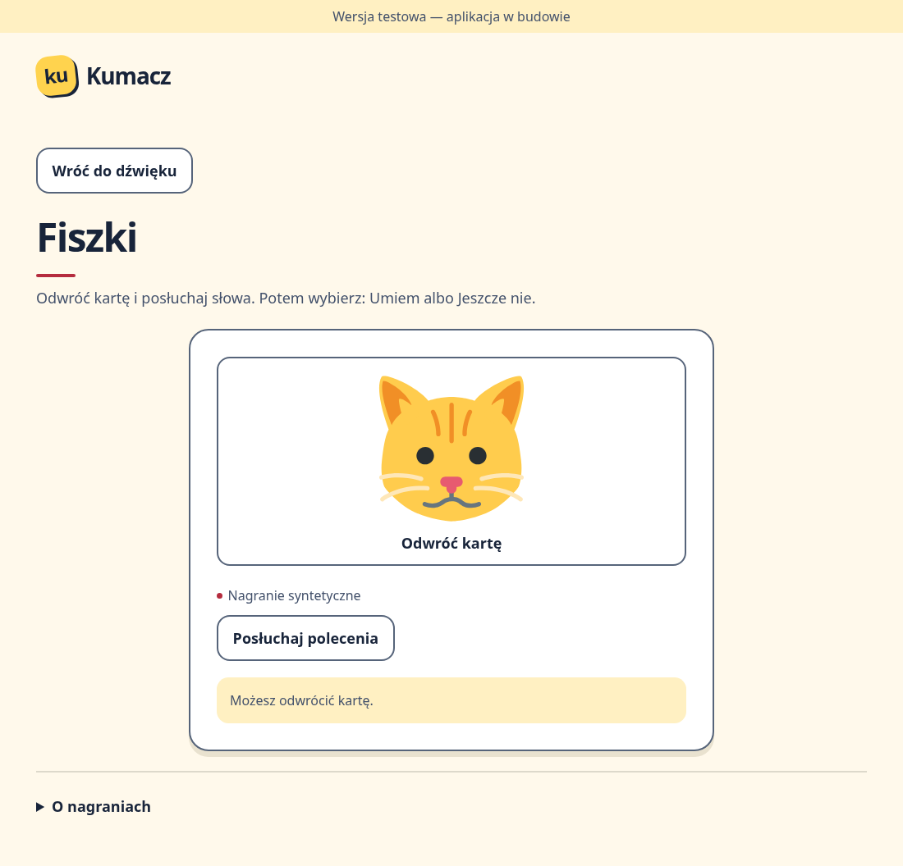
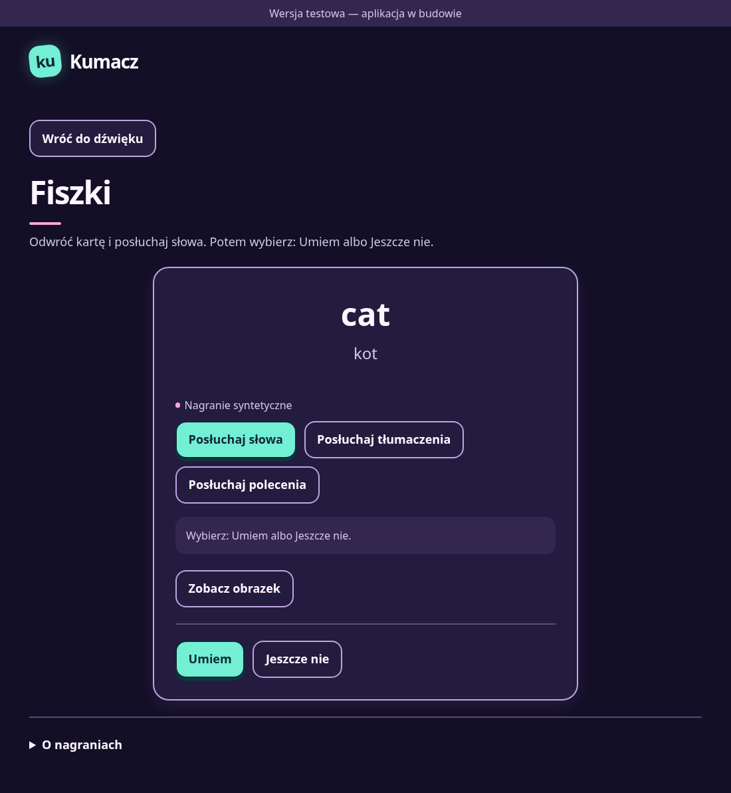

# Flashcards — P08

**Prepared:** 2026-11-11, on `feature/p08-flashcards`, based on unmerged P07 at the owner's request.

P08 implements F-08/F-39: picture front, English word/pronunciation and Polish translation on the back, then **Umiem** / **Jeszcze nie** self-assessment. Neither answer promotes a Leitner box, completes a word/lesson or enters checked-answer history (D-33, F-34).

## Review and branch order

P07 remains unmerged in [PR #21](https://github.com/bartosz-szubert/kumacz/pull/21). P08 uses `feature/p07-listen-and-tap` as its temporary review base, starting at `f96a4e4`. The P08 PR is a draft to prevent merging it into that feature branch. Review the P08 diff independently; after explicit owner approval and P07's merge, retarget P08 to `main`, reconcile any intervening changes and obtain P08 merge approval. Preparing P08 does not accept or merge P07.

On this branch, run `npm ci`, `npm run build`, then `npm run preview -- --host 127.0.0.1 --port 4173 --strictPort`. Open `http://127.0.0.1:4173/kumacz/` and choose **Wypróbuj fiszki**. Try both sides, word/translation/instruction audio, both self-assessments, next card and return to the audio screen. The preview cycles the seven accepted P04 words without saving progress or awarding rewards.

| Electric — picture front | Neon — word back |
|---|---|
|  |  |

[Neon phone view, 360 px](review/p08-neon-phone.png). These are real Chromium production-preview renders. Images/word audio retain the accepted [P04 attribution and provenance](PILOT_LESSON.md).

## Behaviour and reuse

- [The domain result](../src/domain/flashcards.ts) is explicitly `kind: 'self-assessment'`, with stable card/word IDs and `know` / `not-yet`. It has no `correct` field. [The controller](../src/features/flashcards/controller.ts) accepts at most one response, only after revealing the back; later grading/saving code must preserve this distinction.
- The front renders only the picture and flip action. English/Polish answers and their playback controls are absent until the card is flipped. The front waits for its picture; a missing image offers retry. The [view](../src/features/flashcards/Flashcard.tsx) uses native buttons, shared theme tokens, touch targets ≥48×48, keyboard focus and instant side changes without flip animation. The theme selector remains outside the exercise.
- Flipping to the back starts the accepted English clip from the same tap when automatic voice-over is enabled (F-07). With it off, quiet visual study and manual playback remain available. Word, translation and Polish instruction replay use the existing P03 player/local-only fallback. **Nagranie syntetyczne** stays beside the controls on both sides.
- Flipping back stops current audio and hides word/translation. Disposal and newer playback invalidate older completions. The caller owns controller lifetime and calls `dispose()` before changing cards or leaving; React reads immutable snapshots with `useSyncExternalStore`.
- While audio is playing, self-assessment waits for it to finish. Failed audio offers retry and never becomes a checked error. A flashcard remains ungraded: the child may still self-assess the visible written word after playback failure. Both responses keep progress/history unchanged; no mastery or lesson completion is inferred.
- `onAssessed` emits the ungraded result once; continuation is a separate caller action. P09 integrates the pilot flow, P11/P12 handle persisted session progress and save failures. P08 adds no stored fields, profile defaults, session composition or reward rules.

## New Polish instruction

**Synthetic recording for listening review:** [play/download the new prompt](../public/assets/audio/shared/pl-PL-flashcard.d1b916e98e68.mp3): “Odwróć kartę i posłuchaj słowa. Potem wybierz: Umiem albo Jeszcze nie.” It is also available through **Posłuchaj polecenia** on either side.

Generated locally with the existing hash-pinned sherpa-onnx 1.13.8 environment, approved Supertonic 3 preset 0, eight steps and actual `lang=pl` configuration (D-83). Same model/output terms and permanent disclosure as [the existing asset review](ASSET_LICENCES.md). No model, hosted service or preparation dependency is shipped to the browser. No accepted P04 clip or image was regenerated.

[flashcard-audio-provenance.json](../tools/content/flashcard-audio-provenance.json) records the exact text, reviewed archive/input hashes, voice settings, source/output hashes, WAV→MP3 conversion and measured constant gain. MP3: mono, 22,050 Hz, 64 kbit/s; decoded active RMS −20.493 dBFS, sample peak −4.255 dBFS. Full decode/format/synthetic metadata and non-saturated source PCM were checked. No trimming, time stretching or dynamic compressor was used. These checks establish technical integrity, not pronunciation or child comprehension; the new prompt awaits listening review.

Regenerate with the existing [pinned preparation recipe](../tools/audio/README.md), using `--manifest tools/content/flashcard-audio-provenance.json`; remeasure and listen before replacing the hash-named output. Preserve [the public notice](../public/assets/NOTICE.txt).

## Verification

- Frozen offline npm install with scripts disabled; no dependency/lockfile changes. `npm run check` and **59 Vitest cases** passed, including 10 new controller cases and the new instruction/provenance data check.
- **35 Chromium cases** passed (29 existing + 6 flashcard flows). Both self-assessments were exercised against a real seeded IndexedDB profile: revision, box, completion flags and lesson/level IDs remained identical and checked-answer history stayed empty. Other flows cover front/back visibility, the full new prompt, accepted word/translation playback, image/audio retry, keyboard control, phone touch targets/no overflow and theme restoration.
- Three existing Python generator regressions passed against the real pinned binding/FFmpeg. The controller tests failed before implementation; the browser launcher test failed before the entry existed. Inverting the front/back assessment guard made the front-only regression fail; the source was restored byte for byte before final checks.
- Real screenshots were visually inspected in both palettes and at phone width, with no page errors. WebKit's executable is unavailable; its project remains enabled. Actual tablet/child checks remain P09/P10. P04 observations and P06's P12/P27/P33 follow-ups remain scheduled.

The repository's TDD, source-driven-development and code/security review workflow was applied. P07 and P08 both await owner acceptance and explicit merge approval.

Sources: [React external-store snapshots](https://react.dev/reference/react/useSyncExternalStore), [DOM refs](https://react.dev/reference/react/useRef#manipulating-the-dom-with-a-ref), [React 19 ref props](https://react.dev/reference/react/forwardRef), [P03 audio contract](AUDIO_PLAYER.md), [shared controls/themes](SHARED_UI.md).
