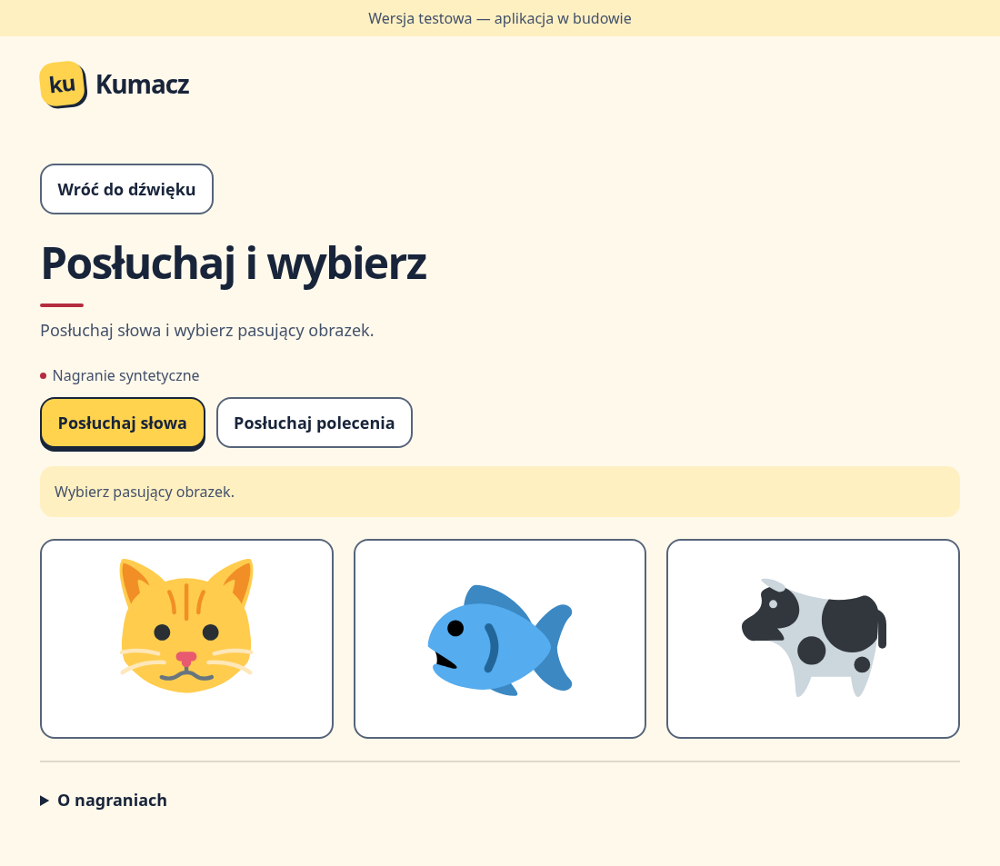
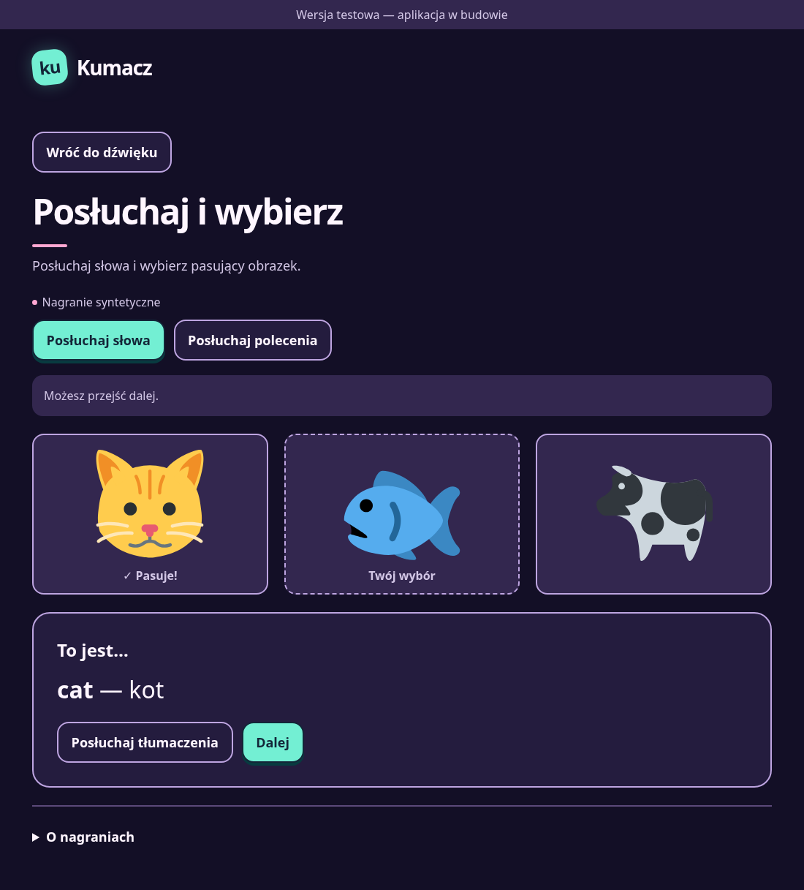

# Listen and tap — P07

**Prepared:** 2026-11-11, for review on `feature/p07-listen-and-tap`.

Implements F-09 with the accepted P04 animal pictures/audio and P03 player: hear the word, choose a picture, then see the correct English word and Polish translation (F-06, F-39–F-41). The audio-check screen now has a **Wypróbuj ćwiczenie** button for review. Actual profile/session integration remains P09.

## Review

On this branch, run `npm ci`, `npm run build`, then `npm run preview -- --host 127.0.0.1 --port 4173 --strictPort`. Open `http://127.0.0.1:4173/kumacz/`, optionally select Neon, and press **Wypróbuj ćwiczenie**. Try correct/wrong choices, word/instruction/translation replay, **Dalej**, keyboard operation and return to the audio check. The preview cycles through the seven accepted words, with no saved progress or rewards.

| Electric — ready to choose | Neon — answer feedback |
|---|---|
|  |  |

[Neon phone view at 360 px](review/p07-neon-phone.png). These are actual Chromium production-preview renders, not Android-device results. Picture attribution and accepted content: [PILOT_LESSON.md](PILOT_LESSON.md); the app also links the existing public asset notice.

## Contracts

- [Domain functions](../src/domain/listenAndTap.ts) build three/four distinct choices and check stable IDs. Fisher–Yates varies the target position without changing the curated set. [The content adapter](../src/features/listenAndTap/question.ts) resolves only same-lesson choices and rejects a curated confusable pair anywhere in the full option set, including between distractors.
- [The controller](../src/features/listenAndTap/controller.ts) is independent of React/storage and consumes P03's `play`/`stop` boundary. A word counts as heard only after a complete `played` outcome from a bundled file or eligible local fallback. Unavailable/cancelled playback leaves the question ungraded. Playing the Polish instruction is not evidence of hearing the English target. Replaying the target requires successful playback again before selection.
- `start()` is called from the entry/continue tap, before any await, so P03 can resume audio within user interaction. Automatic voice-over defaults on under F-07 and can be disabled by a caller; the word button remains available. A wrong choice always reads the correct word (F-06), including with automatic voice-over off.
- `select()` returns one checked result per question: question ID, word ID, chosen ID and correctness. It refuses premature, foreign and repeated selections. Feedback audio failure retains that checked result and offers replay; it cannot change an already valid answer into a new error.
- The owner of a controller calls `dispose()` when leaving or replacing its question. Disposal stops audio and invalidates pending completions; newer playback also invalidates older completions. The React view reads immutable snapshots with `useSyncExternalStore` and emits the optional `onChecked` result once. The caller owns continuation and later persistence.
- [The view](../src/features/listenAndTap/ListenAndTap.tsx) also waits for **all pictures** to load. A broken picture disables selection and offers a retry of the same picture set. No answer/translation appears while the task is ungraded. Before answering, native picture buttons have neutral numbered labels rather than English-word or translation hints; after answering, the solution is explicit in text and picture feedback.
- Native buttons support touch and keyboard, with ≥48×48 targets, visible focus and feedback beyond colour alone. Heading focus follows entry/new questions and feedback; the full feedback panel is brought into view without animation. Both themes use the same controls/content; the theme selector is absent during the exercise (F-31). Shared reduced-motion rules apply. **Nagranie syntetyczne** remains beside the controls (F-45).

The preview host is a review route, not a scheduled learning session. P09 adds the pilot profile/session flow; P11/P12 own progress/reward commits and save failures; P14/P16 own session composition and delayed/carryover retries. This stage adds no profile defaults, storage fields, scheduling or reward amounts. The accepted recordings, graphics and content IDs are unchanged. Existing P04 picture-framing/leading-silence observations remain for the pilot.

## Verification

- Frozen offline install from the existing cache with scripts disabled; no dependency/lockfile change.
- `npm run check`: TypeScript and production build.
- `npm test`: **48 Vitest cases**, including 14 new domain/controller cases for choice positions, curated sets, checked results, audio readiness, repeated selection, superseded/cancelled playback, disposal, local fallback and automatic-voice preference.
- `PLAYWRIGHT_CHROMIUM_EXECUTABLE_PATH=/usr/bin/chromium npm run test:e2e -- --project=chromium --workers=1`: **29 Chromium cases**, including 5 new exercise flows plus the existing 24 audio/storage/UI regressions. New cases cover correct/wrong answers, translation timing/replay, target-audio retry, image-failure retry, next-question reset, keyboard choice, 360 px touch targets, no overflow and theme restoration.
- RED: the unit modules were initially absent and the browser could not find the exercise launcher. The missing-picture browser regression then failed before image-readiness protection was added. Inverting the controller's required-audio guard made the ungraded-question regression fail; the controller was restored byte for byte before final checks.
- Screenshots were visually inspected in both palettes and at phone width. Real tablet/child checks remain P09/P10. The WebKit executable is unavailable in this environment; its configured project remains enabled and no new Safari result is claimed.

The implementation follows the repository's TDD/source-driven-development workflow and received Codex's correctness, architecture, security and test review. P06's P12/P27/P33 follow-ups remain scheduled. Owner review and explicit merge approval are pending.

## Sources

- [React external-store snapshots/subscriptions](https://react.dev/reference/react/useSyncExternalStore), used consistently with the existing audio hook.
- [React DOM refs and focus](https://react.dev/reference/react/useRef#manipulating-the-dom-with-a-ref).
- [MDN `scrollIntoView` alignment and instant scrolling](https://developer.mozilla.org/en-US/docs/Web/API/Element/scrollIntoView).
- [P03 playback contract and sources](AUDIO_PLAYER.md), [shared theme/control contracts](SHARED_UI.md), [accepted content/provenance](PILOT_LESSON.md).
