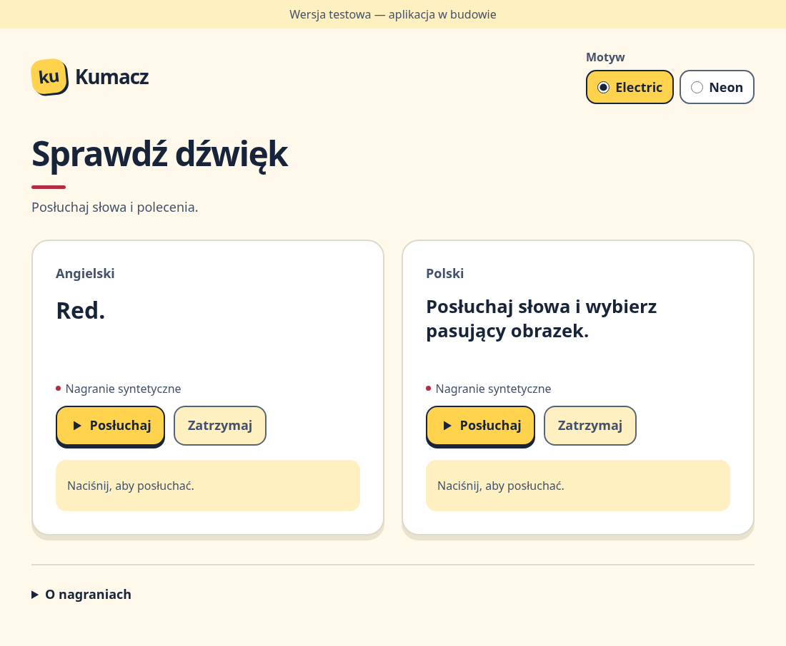
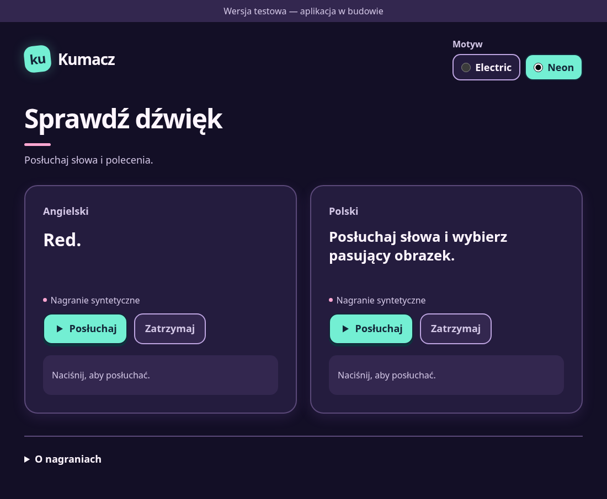

# Shared UI and themes — P05

**Accepted:** 2026-11-10, with the owner's explicit PR #19 merge approval after Claude's second review.

P05 provides the responsive shell and common controls for the upcoming pilot screens. The existing audio check demonstrates both PRD palettes: Electric uses a light background with yellow/red/navy accents; Neon uses dark purple, pink and turquoise with static glow. Both preserve the same content, controls, layout and audio behaviour (F-32). The test-build banner remains visible (D-85).

## Review the appearance

The screenshots are real production-preview renders in Chromium, not mockups. The phone view is a responsive sanity check, not an Android-device test.

| Electric | Neon |
|---|---|
|  |  |

[Neon at 360 px](review/p05-neon-phone.png).

Locally, run `npm ci`, `npm run build`, then `npm run preview -- --host 127.0.0.1 --port 4173 --strictPort` and open `http://127.0.0.1:4173/kumacz/`. Select Electric/Neon, play/replay a sample, try keyboard Tab/arrows, open the credits and resize or rotate the viewport.

## Reuse contracts

- `src/components/AppShell.tsx` owns a theme-scoped container, the test banner, branding, keyboard skip link, main landmark, header actions and optional footer. Pass a `theme` and the screen content; feature code owns headings and actions. Header actions are optional so an exercise screen need not expose a theme switch (F-31).
- `src/components/Button.tsx` retains native button semantics, attributes, events and disabled behaviour. It defaults to `type="button"` and supplies primary/secondary visual tones; a form's deliberate submit action can pass `type="submit"`.
- `src/components/ThemeSelector.tsx` is a controlled native radio group. Its caller supplies the value and handles changes; each instance has its own group name. Native Tab/arrow handling and associated labels provide keyboard and touch operation without a custom ARIA widget.
- `src/domain/theme.ts` contains only the stable `electric`/`neon` preference identifiers, with no React or storage dependency, for later profile/data integration.
- `src/app/themes.css` holds semantic colour/shadow tokens. Shared geometry, typography, focus and interaction styles live in `app.css`. Text is at least 16 px at normal browser text settings; buttons are at least 48×48 px (normally 56 px high), with visible focus and text labels.
- Short button transitions use 160 ms. `prefers-reduced-motion: reduce` removes descendant transitions/animations and hover/press translation. Neon glow is static. P22 still owns actual reward UI and its verification (F-21).

The audio-check host uses temporary React state to preview the palettes, starting with Electric solely for this test screen. This is not a production default-profile decision. It writes no theme preference to storage. Per-profile loading/saving and the profile/parent controls remain P06/P29/P33, and learning exercises remain P07/P08. The accepted P04 content/audio and the P03 player policy remain their existing inputs.

## Verification

- `npm run check`: TypeScript and the static production build.
- `npm test`: 20 existing Vitest checks for player/data/content.
- `PLAYWRIGHT_CHROMIUM_EXECUTABLE_PATH=/usr/bin/chromium npm run test:e2e -- --project=chromium --workers=1`: 14 Chromium cases, including the 9 audio regressions and 5 new UI cases.
- New cases cover native theme selection with arrows, preserved audio/content during a theme change, skip-link/main focus, visible button focus, touch targets, contrast, reduced motion, 360 px phone sanity, tablet portrait/landscape and 200% root text size without horizontal overflow.
- Computed opaque text/background pairs meet at least 4.5:1; secondary control borders meet 3:1. The focus palette has minimum contrast 6.51:1 (Electric) and 11.04:1 (Neon) against the screen/card backgrounds. These checks verify these elements, not full WCAG conformance.
- The browser test failed before the theme controls existed. Temporarily forcing every theme selection to Electric made the theme-switch regression fail; the source was restored and the production build regenerated.
- Visual inspection covered both desktop palettes and a 360 px Neon render, with no page errors. Browser automation does not substitute for target-device validation. The configured WebKit executable is not installed in this environment, so WebKit remains unexecuted; the known official-download restriction is recorded in `AUDIO_PLAYER.md`. No test skip or browser-project removal is introduced.

## Second review — 2026-11-10

The product owner supplied Claude's review of P04/P05: types/build, 20 unit tests and 14 Chromium cases pass. Claude reports P05 consistent with F-31 and no blocking findings. This is the reviewer's reported result; the verification above records Codex's implementation checks. Per-profile persistence and profile/parent controls remain later stages as described above.

The two non-blocking P04 observations are recorded in [the pilot lesson](PILOT_LESSON.md#second-review-and-pilot-observations--2026-11-10). The owner accepted P05 and explicitly instructed merging PR #19 on 2026-11-10. Next is P06 Data layer core.

## Sources

[React 19.3 controlled inputs](https://react.dev/reference/react-dom/components/input#controlling-an-input-with-a-state-variable), [React useId](https://react.dev/reference/react/useId), [reduced-motion media query](https://developer.mozilla.org/en-US/docs/Web/CSS/@media/prefers-reduced-motion), [WCAG text contrast](https://www.w3.org/WAI/WCAG22/Understanding/contrast-minimum.html), [non-text contrast](https://www.w3.org/WAI/WCAG22/Understanding/non-text-contrast.html), and [Playwright assertions](https://playwright.dev/docs/test-assertions).

No font, UI framework, icon package or network service was added. The small play triangle and text-based Kumacz mark are local primitives; no agent-skill artwork or third-party brand asset is copied into the app.
